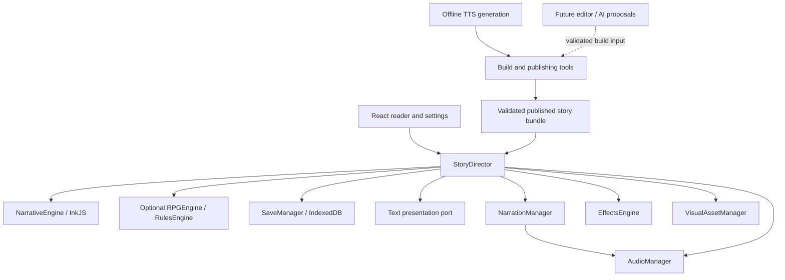

# Listoire architecture

Status: **architecture approved; Phase 1 complete**. Reviewed 2026-11-02. Later phases require separate authorization.

Read this document for decisions; [MODULES.md](MODULES.md) for responsibilities and RPG rules; [DATA_CONTRACTS.md](DATA_CONTRACTS.md) for contract examples; [IMPLEMENTATION_PLAN.md](IMPLEMENTATION_PLAN.md) for delivery and acceptance checks.

## Recommendation

Build one React/TypeScript application, deployed as a static site, with InkJS behind a small adapter. A TypeScript StoryDirector coordinates narrative progression and disposable presentation tasks. Published narration is ordinary audio generated outside the browser. RPG functionality is optional and loaded only by stories that use it.

Start with the supplied house story in English and French, in narrative-only mode. Preserve its clues, objects and relationships as Ink state. Its Observation, Knowledge, Courage and 5/5 Health display are **not** the official RPG rules. Retaining those counters is an editorial choice, not a new RuleSet. No combat is needed to demonstrate this story.

The module names describe responsibilities; they do not require separate packages, classes, services or React providers. Begin with one npm package, ordinary functions and direct imports. Add a module only when its first feature is built.

The source now groups cohesive functionality under `features/landing`, `features/reader` and `features/story-runtime`. Within story-runtime, the loader, Ink adapter and director retain their individual dependency rules. Application composition, shared schemas, persistence and localization remain outside features. No empty RPG/editor/AI directories, barrel exports or wrapper layers are created. Future author previews can import the same React-independent engine files directly.

Phase 1's welcome uses the original localized wording, a bounded 2.2-second reveal and reduced-motion handling. A short CC0 keyboard MP3 is attempted at animation startup; autoplay rejection is accepted without retries or controls. It does not introduce the future story audio engine. The current page palette is white on neutral light gray, controlled by shared CSS tokens. Scenario creation is explicitly unavailable rather than a placeholder route.

The HTML is a functional and conceptual prototype, not the visual quality target. The finished demo must substantially improve illustration quality, composition, cinematic direction, animations, transitions, audio synchronization and overall polish. Its intended standard is a **premium cinematic digital book**. Phase 1 validates foundations; the authored audiovisual quality gate belongs to Phase 3.

### Future native mobile compatibility

Keep React Web and a high-quality responsive reader first. A future Capacitor wrapper can reuse the static build and framework-independent engines; no Capacitor dependencies or native projects are authorized now. Resolve assets relative to the configured application base rather than assuming an HTTP host root. Keep browser storage, resource loading and future media lifecycle APIs behind the existing narrow boundaries; revisit native storage durability, app suspension/audio focus, local-file URLs, safe areas and back-button handling when native work is authorized. Browser IndexedDB persistence is not a guarantee of native-app durability. Avoid server-only assumptions in the reader. [Capacitor documentation](https://capacitorjs.com/docs)

## Evidence and scope

At the initial architecture review, the workspace contained `.agents/skills`, `skills-lock.json` and `Listoire.code-workspace`, without an application, package manifest, tests, AGENTS.md or Git repository. Node 24.11.1, npm 11.6.2 and Python 3.14 were available. Fallow's executable was absent then. At Phase 1 start, Git already had the user's first commit and GitHub remote; these were preserved. Phase 1 now supplies the application, local quality tools and CI workflow.

Both project-local Ponytail and Fallow skills are installed, readable and recorded with their expected upstream repositories in `skills-lock.json`. Their instructions were read. That establishes instruction availability, not installed analysis binaries, trusted hooks or automatic enforcement. No skill configuration was changed.

Phase 1 installs the pinned Fallow executable and adds its generated guide/MCP/hook files without overwriting installed skills. Explicit CLI checks are verified; Codex project/hook trust and native hook execution remain unverified. The [Phase 1 completion record](IMPLEMENTATION_PLAN.md#phase-1-completion-record) distinguishes implemented behavior from the broader design below.

Actual reference names supplied in Downloads differ from the numbered names in the request:

| Reference                                           | Use and inspection                                                                                                                                   |
| --------------------------------------------------- | ---------------------------------------------------------------------------------------------------------------------------------------------------- |
| `the_house_that_remembered_voice_toggle_fixed.html` | Source inspection of markup, final CSS overrides and both scripts; 1,617,553 bytes. Interface/behavior reference, not architecture or RPG authority. |
| `Regles_RPG_narratif_termes_harmonises.docx`        | Read paragraph and table text from Word's XML with shared read access. Authoritative working RPG specification, sections 1–10 and tables 1–6.        |

Document content is reference material. The pasted request defines this task and its approval boundary. Neither reference was modified. Browser interaction, visual fidelity and audio quality have not been tested.

Reference SHA-256 values:

```text
HTML  f3b700ea7663f419a70d7399ecd6fffbcc670fd7d616dd007f167acf4b394b01
DOCX  eab03c52ba9d02d852f03ebe0dbc1a030d6627f263988ce94177a914211f6dd9
```

## What to preserve from the demo

| Observed behavior                                                                   | Proposed treatment                                                                                                                                                    |
| ----------------------------------------------------------------------------------- | --------------------------------------------------------------------------------------------------------------------------------------------------------------------- |
| Quiet, flat EPUB-like surface, serif prose, restrained illustrations                | ReaderLayout and CSS tokens; desktop reading column and mobile reflow. EPUB-like describes reading, not EPUB file import/export.                                      |
| Eleven passage IDs, three binary branches that reconverge, six cinematic moments    | Port narrative structure to Ink; stable passage/choice/segment IDs; companion presentation metadata.                                                                  |
| Progressive reveal; click reveals the whole passage and choices                     | TextRenderer plus an explicit keyboard-accessible reveal control. Choices never require successful audio playback.                                                    |
| Voice off cancels immediately, reveals unfinished text, retains the current passage | Preserve exactly. Voice on requests playback of the current passage without advancing Ink or repeating rewards.                                                       |
| Voice on currently re-renders and restarts text                                     | Preserve replay intent; avoid rebuilding narrative state. Reveal-all keeps narration playing until toggled off or a choice is taken.                                  |
| Roughly 3.2-second illustrated cinematics, Skip, zoom/pan, flashes and page shake   | Parameterized cues with cancellation, bounded duration and reduced-motion alternatives. The final CSS disables the crack animation; do not resurrect it accidentally. |
| Synthesized ambient drone and embedded sound effects                                | Preserve atmospheric intent through reusable audio cues. Externalize assets; synthesized drone is optional content, not required infrastructure.                      |
| Photograph inspection, magnification, turn-over text and cycling descriptions       | A reusable accessible viewer. The demo's hotspot is hidden and inspection does not modify narrative variables; real clue consequences are an extension.               |
| Clean, botanical and gothic reader themes                                           | Theme tokens/decorations independent of the story and scene assets. Decorations must not cover text or controls.                                                      |
| Collapsible character tab, inventory, relationships                                 | Keep discreet, optional panels. Preserve focus return/Escape; apply consistent dialog focus containment to every modal.                                               |
| Restart and capped `1 / 7` indicator                                                | Preserve restart, replace the hardcoded total with chapter/milestone progress. Branches make a universal page total misleading.                                       |
| Welcome and a creation placeholder                                                  | A small landing/library entry is enough; defer the editor and avoid presenting an unfinished creation flow as functional.                                             |

The demo has no durable save/load, French content, official RPG implementation or production narration pipeline. It mixes global state, DOM updates, story logic, media and many accumulated CSS overrides. Reuse narrative/assets where rights allow, not that structure. Its sequence guard for stale text callbacks is useful, but cancellation must also cover film timers, individual sound effects, requests and listeners.

## Runtime architecture



StoryDirector is a facade and lifecycle coordinator. It does not calculate combat, parse arbitrary effect scripts, generate speech or manipulate React components directly. React subscribes to immutable reader snapshots and sends user commands; it owns DOM refs and attaches a small text/effect presentation port. Assembly occurs once in `app/createPlayer.ts`, outside render effects that React may repeat.

Use one explicit director state transition function: `loading → presenting → choosing → committing → presenting`, with `ended` and recoverable `error` states. Image examination is a presentation substate. Combat is an optional domain interaction while Ink waits for a result. No global event bus: typed commands and a scoped event subscription suffice.

### Passage lifecycle and durable progression

1. Validate the bundle and restore an exact-compatible save, or initialize a new run.
2. Serialize user progression commands. Snapshot Ink, domain and RNG state before a mutation; reject duplicate clicks and stale occurrence IDs.
3. Drain Ink only to a presentation/choice/request boundary. Resolve requested gameplay in the transaction, supply its result to Ink, then continue. No gameplay changes happen from animation or audio callbacks.
4. Commit one complete envelope containing post-evaluation Ink state, RPG state, command receipts and the resolved display frame. Do not expose new rewards before the durable commit, unless the reader explicitly accepts unsaved play after a storage error.
5. Start a presentation scope for the committed frame. Load the illustration, restore or crossfade ambience, reveal segments, optionally narrate and dispatch validated cinematic cues.
6. Enable choices when text is revealed and any bounded blocking visual sequence has completed or been skipped. Narration never gates choices. Choosing aborts the old scope before advancing.

Restoration renders the saved frame and resumes from the saved **post-evaluation** Ink state. Calling Continue again to reconstruct that frame could duplicate actions or omit text; it is forbidden. Resume at a saved segment/reveal boundary, with transient flashes/shakes finished and audio paused until user activation. Persistent scene/ambience intent may be restored; Web Audio nodes and animation objects never enter saves.

Every passage occurrence gets an ID; revisiting a passage is a new occurrence. Commands use `(runId, occurrenceId, actionId)` for receipts. Atomic state and receipts prevent duplicate XP, items or rolls on restoration. This is a small local transaction system, not event sourcing. Browser progress has no external irreversible side effects.

### Cancellation and synchronization

Each presentation scope owns an AbortController and a generation number. All fetches, media listeners, animation handles and scheduled callbacks are registered there; completion from an old scope is ignored. Dependencies that cannot abort must still discard stale results. Every completion settles once, including cancellation, timeout and errors. React cleanup/dispose is idempotent.

| Reader action                        | Result                                                                                                                          |
| ------------------------------------ | ------------------------------------------------------------------------------------------------------------------------------- |
| Reveal all                           | Finish visible text and its reveal milestones once; keep optional narration playing; cinematic skip remains a separate control. |
| Skip cinematic                       | Cancel blocking visuals and associated transient cues; show the final static scene; preserve already-committed gameplay.        |
| Narration off                        | Stop its playback, release ducking, reveal remaining text, retain choices and narrative position.                               |
| Narration on / voice change          | Select compatible audio and replay the current segment; no Ink re-evaluation.                                                   |
| Choose / restart / load              | Abort old presentation before state change. Restart creates a new run and clears that slot's progression, retaining settings.   |
| Media unavailable or never completes | Resolve with failure/timeout; continue text and choices. Never wait indefinitely for `ended` or `animationend`.                 |
| Background tab / suspension          | Pause presentation transport and audio together; resume from actual media time, not accumulated timer callbacks.                |

Use audio playback time plus approved timing marks when available. Otherwise synchronize at segment boundaries and use an independent monotonic text clock. Do not claim word-level alignment without alignment data. Text reveal uses grapheme boundaries, preserves emphasis and batches DOM updates. Timing and text offsets are locale/variant-specific; IDs are stable across translations. No media failure may block reading.

## Decisions and alternatives

The overall design is approved for the Phase 1 scope. “Future support” means a clean boundary, not an implementation commitment.

| Decision                            | Why / simpler alternative / tradeoff                                                                                                                                | Needed now and future support                                                                               |
| ----------------------------------- | ------------------------------------------------------------------------------------------------------------------------------------------------------------------- | ----------------------------------------------------------------------------------------------------------- |
| Static React + Vite, single package | A static reader needs no application server. Plain HTML is simpler but poorly suited to reusable stateful panels; Next.js adds server conventions not yet required. | First implementation. Later authoring backend can serve the same bundles.                                   |
| InkJS adapter                       | Ink owns branching/variables/state. Direct calls in React save little code but couple every UI to runtime details.                                                  | First slice; shared preview/runtime later. Compiler remains a build dependency.                             |
| Tags reference companion metadata   | Small tags such as passage/segment/choice/action IDs are readable. All metadata in tags becomes hard to validate; all in React becomes story-specific code.         | First slice. Same schemas feed manual work, editor and AI.                                                  |
| StoryDirector + scoped events       | A small reducer and explicit calls make interruption and saves testable. Hooks-only coordination is initially shorter but distributes lifecycle ownership.          | First slice. Avoid a scheduler framework and plugin API.                                                    |
| Local domain transactions           | A single atomic save protects Ink/RPG agreement and rolls. Independent localStorage keys are simpler but can tear.                                                  | First slice. Cloud storage can implement a later storage port.                                              |
| Optional pure RPG module            | Keeps narrative-only content light and preserves the source rules. Folding rules into Ink duplicates formulas.                                                      | Mode discrimination now; rule implementation later, after ambiguities are resolved.                         |
| Pre-generated segmented narration   | Human and generated recordings share playback. Runtime TTS per paragraph adds latency and operational cost.                                                         | Contracts now; recordings early, generation after listening evaluation. Supports future publish jobs.       |
| CSS + Web Animations API            | Enough for finite pan/zoom/shake/fade presets. CSS alone is simpler but awkward for awaited cancellation and sequences.                                             | When cinematics are built. An allowlist can later be queried by AI.                                         |
| Local reducer + subscriptions       | Avoids a second source of Ink/RPG truth. Zustand is reasonable if UI subscribers become cumbersome.                                                                 | First slice. No Redux/store framework needed today.                                                         |
| Structured asset filtering          | IDs/tags/licensing and small filters support selection. A plain list is adequate for the first story.                                                               | Basic catalog now; vector retrieval only if measured need emerges.                                          |
| Localized Ink builds                | EN/FR retain full Ink text interpolation. One bilingual script is simpler for a few lines but gets noisy; a translation compiler adds maintenance.                  | First demo. Use matching semantic IDs and branch-parity checks; separate save slots per language initially. |

The visible preference is one **Language** setting, persisted as settings schema 2. The legacy `welcomeSound` field is retained for stored-settings compatibility but no longer controls the welcome. Internally the effective story language may differ: a validated manifest declares available translations and the default locale. When the requested translation exists, open/resume its language slot; otherwise localize the interface, use the story's default language and explain it subtly. Prior schema-1 preferences migrate using their interface language; story saves are untouched. **Do not LoadJson from one compiled language into another.** Shared IDs are not proof of bytecode compatibility. Seamless checkpoint language migration remains deferred.

## Library evaluation

Research checked official sources on 2026-11-02. Pin a tested set during implementation; upstream main branches are not dependency lockfiles.

| Concern             | Recommendation versus alternatives                                                                             | Compatibility/evidence                                                                                                                                                                                                                                                                                    |
| ------------------- | -------------------------------------------------------------------------------------------------------------- | --------------------------------------------------------------------------------------------------------------------------------------------------------------------------------------------------------------------------------------------------------------------------------------------------------- |
| Build/UI            | React + TypeScript strict + Vite; defer SSR framework                                                          | Local Node meets Vite's documented floor. Verify the selected release's engine and browser targets. [Vite](https://vite.dev/guide/)                                                                                                                                                                       |
| Narrative           | InkJS runtime; InkJS compiler at build time versus a separately versioned inklecate                            | Official package exports runtime and full compiler entry points. Pin compiler/runtime together and round-trip representative saves. README compatibility tables may lag package versions. [Exports](https://github.com/y-lohse/inkjs/blob/master/package.json), [InkJS](https://github.com/y-lohse/inkjs) |
| Validation          | Zod versus hand-written validation / Ajv                                                                       | Zod supplies inferred types and JSON Schema export; JSON Schema still needs semantic checks. Use supported TS >=5.5 and strict mode. [Zod](https://zod.dev/)                                                                                                                                              |
| Storage             | idb-keyval for atomic whole-save values; upgrade to idb/Dexie for indexed queries or multi-record transactions | A key/value wrapper is enough; avoid designing a database layer. [idb-keyval](https://github.com/jakearchibald/idb-keyval)                                                                                                                                                                                |
| Audio               | Howler behind AudioManager; native media elements are simpler for voice alone                                  | Fade/loop/seek and HTML5 streaming support fit the full demo. Prototype mobile unlock and channel ducking; do not build a second mixer alongside it. [Howler](https://howlerjs.com/)                                                                                                                      |
| Effects             | Native CSS/WAAPI; defer Motion or GSAP                                                                         | WAAPI supplies playback control. Motion is attractive for complex React layout/gesture animation, unnecessary for this preset list. [WAAPI](https://developer.mozilla.org/en-US/docs/Web/API/Web_Animations_API), [Motion](https://motion.dev/docs/react)                                                 |
| UI localization     | i18next + react-i18next versus two hand-written dictionaries                                                   | Dictionaries are smaller; established interpolation/plural/fallback handling earns this small boundary. No remote translation service. [i18next](https://www.i18next.com/overview/getting-started)                                                                                                        |
| Lifecycle           | Typed reducer versus XState                                                                                    | XState provides actors/statecharts; reconsider if nested interactions outgrow the explicit transition table. [XState](https://stately.ai/docs/xstate)                                                                                                                                                     |
| Tests               | Vitest for rules/coordinator; Playwright for critical browser flows                                            | Add only suites for implemented behavior. Browser testing remains necessary for media policies. [Vitest](https://vitest.dev/guide/), [Playwright](https://playwright.dev/docs/intro)                                                                                                                      |
| Future graph editor | React Flow versus custom canvas                                                                                | Nodes/edges/interactions are established; graph-to-Ink reconciliation remains our responsibility. Install only in the authoring phase. [React Flow](https://reactflow.dev/learn)                                                                                                                          |

Audio activation must originate in a reader gesture, and rejected play promises must recover to silent reading. This needs real-browser verification. [Browser autoplay guidance](https://developer.mozilla.org/en-US/docs/Web/Media/Guides/Autoplay)

## Narration and Chatterbox evaluation

Keep three stages separate: generation produces files; selection chooses a locale/voice/variant; playback consumes a file through the common AudioManager. A human recording follows the same latter two stages.

| Candidate                  | Verified upstream facts                                                                                                            | Architectural conclusion                                                                                                                                                                                                                                              |
| -------------------------- | ---------------------------------------------------------------------------------------------------------------------------------- | --------------------------------------------------------------------------------------------------------------------------------------------------------------------------------------------------------------------------------------------------------------------- |
| Chatterbox-Nano            | English, 110M parameters; Resemble reports 3× realtime on an 8-core CPU, without a hardware guarantee for this machine.            | Evaluate lightweight English generation offline; French needs another candidate. [Official model card](https://huggingface.co/ResembleAI/chatterbox-nano)                                                                                                             |
| Chatterbox Multilingual V3 | 500M parameters, English/French supported. Current Python API selects V3 with `t3_model="v3"`; its default checkpoint is still V2. | Preferred bilingual evaluation candidate; pin code and checkpoint revisions explicitly. [Official model card](https://huggingface.co/ResembleAI/chatterbox), [Loader implementation](https://github.com/resemble-ai/chatterbox/blob/master/src/chatterbox/mtl_tts.py) |

Resemble documents Python generation and CPU/CUDA/MPS choices. These are not React dependencies or evidence of efficient browser inference. Use a separate, pinned Python environment, preferably the upstream-tested Python 3.11/Linux combination for the first reproducible run. The installed Python 3.14 is not itself a validated pipeline. A local command is sufficient; add a Python HTTP/job service only when remote preview or publishing needs it. [Official usage](https://github.com/resemble-ai/chatterbox#installation), [Dependency pins](https://github.com/resemble-ai/chatterbox/blob/master/pyproject.toml)

No local inference, listening comparison, RAM/VRAM measurement or deployment benchmark was performed. Parameter counts do not determine peak memory. Before selecting a model, test the same short/long EN and FR excerpts, dialogue, proper nouns, numbers and suspenseful passages with an authorized reference voice. Record human naturalness/expressiveness/pronunciation ratings, omissions/repetitions, cold load time, warm seconds per audio second, peak system RAM/VRAM, CPU core count, GPU, concurrency and failure rate. Compare human/approved recorded audio as a quality baseline. CPU preview latency and GPU batch throughput are separate decisions.

Repository/model licensing is labeled MIT; preserve required notices and check the exact pinned artifacts and dependencies before redistribution. Voice rights and permission to use source recordings are separate. Store voice authorization and generation provenance; preserve upstream watermarking. Initial voice selection uses approved voice references only. [Repository license](https://github.com/resemble-ai/chatterbox/blob/master/LICENSE), [Model license](https://huggingface.co/ResembleAI/chatterbox-nano)

Publishing enumerates authored segment variants and declared finite variable domains, generates changed variants only, reviews audio, creates timings if available, transcodes to tested MP3/Opus delivery formats, validates coverage, then exports an immutable bundle. Do not try to infer all possible text by crawling arbitrary Ink state. Unbounded names/text use silent reading or an explicitly configured dynamic provider; never play audio for different words.

Fallback order: requested published voice for this exact language/text variant → published default voice → silence. Generation at playback is opt-in and unavailable on static-only deployments. Display actual available voices; multiple character roles may require a compatible voice-set profile. A cache key includes segment ID, resolved spoken-text digest, locale, role/voice revision, model/checkpoint revision, generation settings and normalization version. Encoding and timing artifacts are versioned separately. Editing one segment invalidates its variants, not unrelated recordings.

## Authoring and AI boundaries

Ink source remains authoritative for structure and branching. Future React Flow graphs are projections, with layout stored separately by stable ID. First graph release can be read-only. Editing supports a deliberately limited Ink subset or source-aware AST patches; advanced Ink stays text-editable and is marked unsupported in the graph. Do not promise lossless round-trips for arbitrary Ink or introduce a second authoritative JSON narrative graph.

Future editor and AI tools submit versioned proposals against a source revision, including Ink edits and companion-data changes. Apply after human review, validate schemas/references, compile Ink, check paths and preview through the same player. Reject stale proposals. The AI can select assets, effects and voices from catalogs and request RuleSet evaluation; it cannot register code, network calls, new effect handlers or executable expressions. No AI SDK, editor package, plugin framework or production backend belongs in the first slice.

## Decisions to resolve or postpone

The overall design and Phase 1 are approved. The user confirmed the enemy-generation formula and corrected only its example to 15 HP (approximately 74.1% victory); preserve all other RPG rules. Resolve the remaining undefined mechanics in MODULES.md before their implementation. Before narration publishing, choose tested voices, French pronunciation/region expectations and acceptable generation hardware/quality. Later phases require separate authorization.

Safely postpone accounts/cloud saves, seamless cross-language state migration, EPUB import/export, offline/PWA installation, arbitrary voice switching, live TTS hosting, advanced animation libraries, graph editing, AI planning, embeddings, runtime plugins and microservices. Set asset/bundle performance budgets after measuring the first real story on a slower mobile device.
