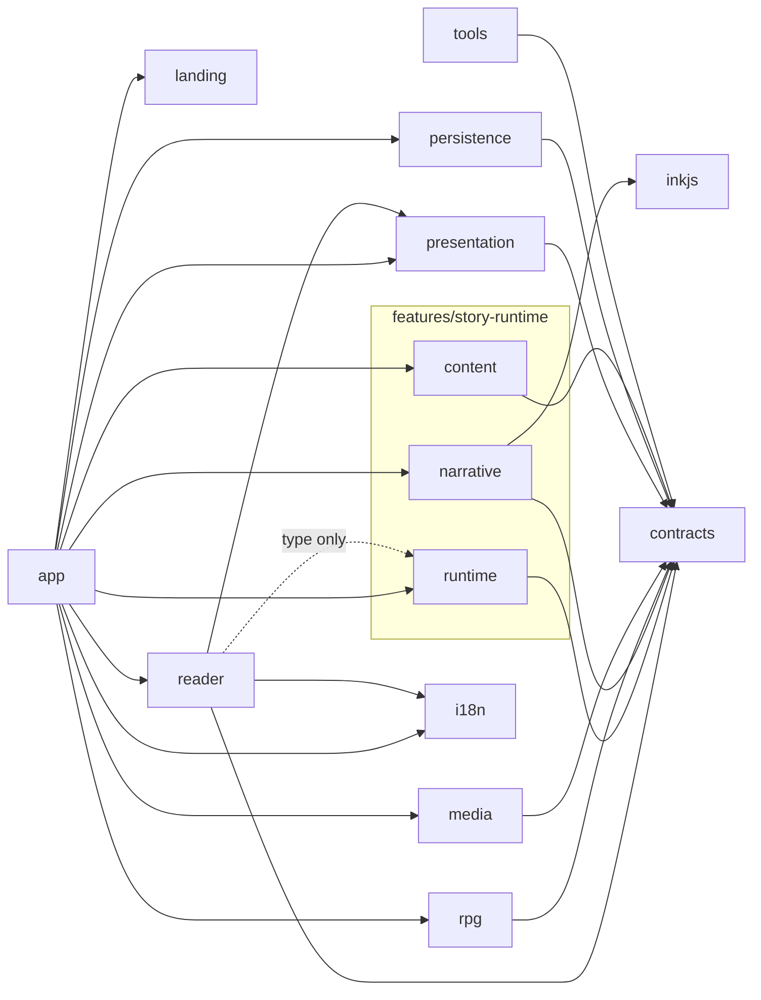

# Modules and rule ownership

Status: approved boundaries; Phase 1 complete. See [ARCHITECTURE.md](ARCHITECTURE.md) for decisions and [DATA_CONTRACTS.md](DATA_CONTRACTS.md) for the implemented subset and later contract sketches. Implemented features are landing, reader and story-runtime, with shared app composition, persistence, contracts, localization and the compiler; optional engines remain deferred.

## Responsibilities

| Module         | Owns                                                                                           | Must not own                                          |
| -------------- | ---------------------------------------------------------------------------------------------- | ----------------------------------------------------- |
| `app`          | Composition, dependency construction, reader lifetime                                          | Story-specific rules or content                       |
| `reader`       | React layouts, controls, dialogs, themes, settings, accessibility                              | Ink calls, dice calculations, TTS generation          |
| `runtime`      | StoryDirector, transition reducer, serialized commands, cancellation scopes, display snapshots | Combat formulas or media-provider internals           |
| `narrative`    | NarrativeEngine adapter, Ink state, tagged output, choices, allowlisted variable bridge        | Audio/DOM/persistence, RPG calculations               |
| `rpg`          | RPGEngine state/actions; pure RulesEngine using one versioned RuleSet                          | React, Ink, persistence, narrative relationship rules |
| `media`        | AudioManager transport/channels; NarrationManager selection and playback orchestration         | Branching, rewards, model inference in the browser    |
| `presentation` | EffectsEngine presets, target binding, cue sequencing; text reveal helpers                     | Gameplay mutations, hardcoded passage IDs             |
| `content`      | Bundle loading, schemas, semantic validation, VisualAssetManager catalog/filter/cache          | Narrative branching or arbitrary effect evaluation    |
| `persistence`  | SaveManager and storage implementation, envelope validation/version policy                     | Re-running story actions or inventing migrations      |
| `i18n`         | UI translations and formatting                                                                 | The authoritative story graph or narration text       |
| `tools`        | Compile/validate/export, later offline narration production                                    | Runtime imports into the reader bundle                |

TextRenderer is a React presentation component backed by small pure reveal helpers. VisualAssetManager is initially a typed catalog lookup plus URL resolution, not a new asset server. Character, statistics, abilities, inventory, equipment, dice, progression, combat, enemies, effects and rules are focused files within `rpg`, not eleven independently initialized engines.

Story relationships live in Ink variables. Narrative-only story objects also live in Ink; RPG story inventory lives in RPGEngine, with read-only queries exposed to Ink. Each value has exactly one authoritative owner. Any mirrored Ink facts are derived, refreshed before narrative evaluation, and cannot be assigned independently.

## Physical feature boundaries

`features/landing` owns the welcome and its small typing presentation. `features/reader`
owns story UI and styles. `features/story-runtime` groups the cohesive loader, Ink
adapter and director without merging their responsibilities. Fallow still treats
these three files as content, narrative and runtime zones; grouping them does not
permit new imports between them. Oxlint prohibits React imports in story-runtime.

`app/ReadingSession.tsx` stays in app because it composes the loader, storage and
React presentation. Shared persistence serves both preferences and checkpoints;
shared contracts/localization serve multiple features. They do not move merely
for consistency. No reusable UI primitives or utility directory is needed yet.

## Compile-time dependencies

Arrows mean “may import”; runtime events do not imply reciprocal imports.



`contracts` contains schemas, inferred DTO types and small runtime ports. It imports no feature modules. Runtime receives port implementations at composition; ports do not require a DI container. Feature-to-feature imports are limited to deliberately declared dependencies, such as NarrationManager using AudioManager within `media`. No catch-all `utils` directory or barrel-export requirement.

Patterns used: adapter for Ink/storage/generation providers; facade for StoryDirector; strategy only for actual alternative narration sources and the versioned RuleSet; typed events for presentation milestones; constructor/function arguments for injection; a small transition reducer for lifecycle. Reconsider abstractions only when a second real implementation needs them.

## Ink integration

Use stable tags for passage, segment, choice and action IDs. Companion JSON maps IDs to visuals/cues/action payloads; Ink retains prose, interpolation, conditions and branches. Never make a cue decide the next passage.

Ink external functions are synchronous. Allow only bounded pure queries such as `has_item(id)`; do not return Promises or mutate domain state, roll dice, write saves or play audio from an external function. Ink's lookahead and evaluation replay make such side effects unsafe. This follows the runtime's documented separation between bound functions and story control. [Ink runtime documentation](https://github.com/inkle/ink/blob/master/Documentation/RunningYourInk.md)

For a gameplay action, use an explicit host-request boundary: a singleton internal Ink choice tagged with an action ID, which the adapter yields as a request rather than displaying. Ink is genuinely waiting at a choice boundary. The director resolves the registered typed action, writes its structured outcome to declared Ink result variables, then consumes that internal choice. Outcomes select ordinary Ink branches. The Phase 1 spike verified this boundary and its restore/result timing with InkJS 2.4.0. Choice tags must be inside bracketed labels (`* [Resolve # request:door.check]`), not after the closing bracket. This is a tested extension point, not an implemented RPG action executor; asynchronous bound functions remain prohibited.

Visible choices also have stable IDs. Only the adapter maps them to ephemeral Ink choice indexes; stale indexes must never escape into UI commands. Image hotspots submit a declared interaction ID to the director, which resolves a permitted action/Ink interaction at the current boundary. They cannot jump to arbitrary Ink paths or set arbitrary variables.

## RPG specification traceability

Authority: the supplied French DOCX, working version, sections and tables below. The machine RuleSet should have an ID/version and the source digest recorded in ARCHITECTURE.md. French source labels stay available even when the interface uses translated labels. No alternative RuleSet is implemented initially.

| Source                   | Required behavior                                                                                                                                                                                                                                                                                                                                                                                                                                        |
| ------------------------ | -------------------------------------------------------------------------------------------------------------------------------------------------------------------------------------------------------------------------------------------------------------------------------------------------------------------------------------------------------------------------------------------------------------------------------------------------------- |
| §1                       | Modes: narrative; RPG without combat; RPG with combat. Noncombat RPG retains attributes, abilities, objects and XP. Narrative mode neither initializes nor loads RPG.                                                                                                                                                                                                                                                                                    |
| §2                       | Start with **6 maximum HP**; STR, DEX and WIL each generated using **3d6**, initial values retained, cap 18. Confirm starting current HP before coding; the text specifies the maximum explicitly.                                                                                                                                                                                                                                                       |
| §3                       | Items can give +1 STR/DEX/WIL, damage or HP; +1 applicable ability rank, capped at 4; or a narrative option. Items persist after use unless consumed/lost. Do not invent automatic depletion.                                                                                                                                                                                                                                                            |
| §4 / tableau 1           | Ability ranks 1–4: success on d6 ≥5, ≥4, ≥3, ≥2 respectively. Exact probabilities 2/6, 3/6, 4/6, 5/6. Rank increases occur through authored training/discoveries/events, capped at 4, independently of XP.                                                                                                                                                                                                                                               |
| §5 / tableau 2           | One approach and one visible action roll: d20 ≤ chosen attribute, or the rank-based d6 ability check. Obvious actions and ordinary item use need no automatic test. Special-effect draws are separately disclosed mechanics, not a second approach roll.                                                                                                                                                                                                 |
| §6                       | Each out-of-combat attribute/ability test earns 1 XP, success or failure. Combat awards 1 XP once on resolution, regardless of duration/outcome. Every 5 XP: reset XP to 0, +1 HP max, +1 random attribute, with cap 18. Then +1 current HP and recover ceil(25% of new max), clamped to max. Preserve example 3/6 → 4/7 → 6/7.                                                                                                                          |
| §7 / tableaux 3–4        | Hero acts first; ordinary attack always deals d6 + attribute damage bonus; successful offensive ability deals 7 + that bonus, failure 0. Surviving enemy retaliates with fixed damage. Continue until victory, flight or narrative defeat. Equip/unequip only outside combat. Attribute bonus: scores 3–9: 0; 10–13: 1; 14–17: 2; 18: 3. Associated weapon/ability attribute can be STR, DEX or WIL. Equipment damage bonuses remain separate modifiers. |
| §8                       | A successful offensive ability with an inactive special effect has an independent 1/3 activation chance. On activation, an independent 1/4 draw gives 3 turns; otherwise 1 turn. No guaranteed quota, stacking or reactivation while active; at most one special effect per combat ability, possibly none. Noncombat abilities need only their rank check.                                                                                               |
| §9 / tableau 5           | Difficulty `Facile / Normal / Difficile / Boss`: adaptation S = 40/60/75/90%; target victory = 90/75/60/50%.                                                                                                                                                                                                                                                                                                                                             |
| §9 / tableau 6           | Profile `Résistant / Équilibré / Offensif`: fixed enemy damage coefficient = 17/25/34% of reference HP.                                                                                                                                                                                                                                                                                                                                                  |
| §9, préparation aux boss | Author offers rest/healing/help toward approximately 80% maximum HP before a boss, contingent on choices. Never heal automatically for boss generation.                                                                                                                                                                                                                                                                                                  |
| §10                      | At 0 HP, return narrative defeat. Ink defines capture/injury/loss/retreat/new branch or game over and how play resumes. Do not assume automatic death.                                                                                                                                                                                                                                                                                                   |

### Enemy generation: exact algorithm and unresolved example

Let `H` be current maximum HP excluding equipment, `A0` the relevant initial attribute, `A` its current value excluding equipment, `S` the difficulty adaptation and `C` the profile damage coefficient.

```text
Href = nearestInteger(6 + (H - 6) * S)
Aref = nearestInteger(A0 + (A - A0) * S)
enemyDamage = max(1, ceil(Href * C))
Hcalc = ceil(Href * 0.80)
N = ceil(Hcalc / enemyDamage)
B = damageBonus(Aref)                           // tableau 4
X = sum of N independent (d6 + B) attacks
enemyHP = positive integer h minimizing |P(X >= h) - target|
tie-break: choose the lower h
```

Use the attribute associated with the **equipped primary weapon**, while excluding that weapon's attribute/damage bonuses; if unarmed, use the highest attribute without equipment. Abilities and equipment bonuses are excluded from reference calculations. Freeze generated statistics at enemy creation; later progression must not regenerate an existing enemy.

The ordinary-attack distribution is finite. Compute exact integer outcome counts by discrete convolution (BigInt where needed), divide by `6^N` only for reporting, and compare target-distance fractions exactly. Search positive HP through `N * (6 + B) + 1`, including probability plateaus; prefer the smallest HP on ties. Monte Carlo is unnecessary for generation and would introduce random instability. Use integer percentage arithmetic for rounding boundaries rather than relying on binary floating-point artifacts. This calculation is design analysis, not application implementation.

**User-approved numerical erratum:** the DOCX example has H=14, initial STR=12, current STR=16, Normal/Équilibré. Its intermediate results are Href=11, Aref=14, damage=3, Hcalc=9 and N=3, all consistent with the formula. With B=2:

| Enemy HP                   | Exact reference victory probability |
| -------------------------- | ----------------------------------- |
| 15                         | 160/216 = 20/27 ≈ 74.074%           |
| 17, stated in the document | 108/216 = 1/2 = 50%                 |

Independent enumeration of all 216 ordinary-attack outcomes selects **15** as closest to the 75% target. The user explicitly approved retaining the written formula and correcting the numerical example to **15 HP at approximately 74.1%**. This erratum is the only rules change; the original DOCX remains unmodified and its original digest remains valid. RPG implementation is deferred beyond Phase 1, with the other gaps below still unresolved.

### Other rule decisions needed before their implementation

These are gaps in the working rules, not permission to fill them with conventional RPG assumptions:

- Half-integer behavior for “nearest integer” is unspecified. Recommend rounding positive halves upward, subject to approval.
- Random attribute improvement at the cap: select among all three and possibly waste the increase, or select only uncapped attributes? What if all reach 18?
- Equipment: stacking/slot limits, HP bonus effects on current HP when equipping/removing, default unarmed attack attribute, and how to break ties between highest attributes for unarmed enemy reference calculations. Preserve the stated attribute cap of 18.
- Special effects: turn definition, whether activation applies before the immediate retaliation, expiration point, scope of the nonstacking restriction, and exact mechanics for charm/stun/weakening. An authored label is not executable rule logic.
- Flee procedure, enemy retaliation after non-damaging actions/items, simultaneous defeat interactions, recovery outside the explicit progression/boss rules, and starting current HP. The document does not define universal rest, potions or flee odds.

Implement only settled actions for each RPG milestone. Never claim full combat conformance while these questions remain unresolved. Persist combat phase, whose action is next, fixed enemy stats, active effects and remaining duration; save only at atomic action boundaries, not midway through applying damage/XP.

## Current folder tree

Only implemented functionality has directories. Unit/integration tests remain
beside the source; browser flows live under `tests/e2e`.

```text
src/
  app/                         # composition, ReadingSession, app.css/tokens
  contracts/story.ts           # shared Zod schemas and runtime types
  features/
    landing/                   # WelcomeScreen, intro hook, optional typing sound
    reader/                    # StoryPlayer and reader.css
    story-runtime/
      bundle-loader.ts         # browser content boundary + manifest validation
      ink-engine.ts            # Ink adapter, no React or DOM
      director.ts              # coordinator, no React or DOM
      *.test.ts
  persistence/                 # shared SaveManager and IndexedDB adapter
  i18n/i18n.ts                 # shared EN/FR UI resources
  main.tsx
  test-fixtures.ts
stories/foundation/
  en.ink / fr.ink
  metadata.json                # ID/release/default locale, titles/chapters, IDs
public/stories/foundation/      # generated manifest and compiled language bundles
  manifest.json / en.json / fr.json
tools/build-story.ts
tests/e2e/                     # welcome and reader browser flows
docs/                          # baseline and critical findings review
```

Future RPG, authoring and AI features can be added under `features/` when authorized;
they are not scaffolded now. Shared schemas and directly importable engine modules
let the future author preview use the same runtime without importing reader React UI.

Extract packages only after actual consumers exist. Publishing/editor code must not enlarge the reader bundle; build tools and future authoring routes are separate entry points with lazy loading where appropriate.
